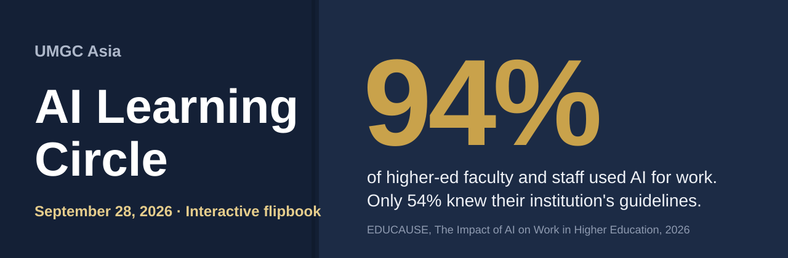

  

&nbsp;

 

**One hour. Six conversations. Talk first, build last.**

---

## 📖 The session

| | Part | What happens | Time |
|:---:|---|---|:---:|
| **1** | **Where are you with GenAI?** | Flip cards turn EDUCAUSE findings into questions. How do you use GenAI for PowerPoints, lesson plans, and activities? What changed since 2022, and why? | 13 min |
| **2** | **AI Use Disclosure Form** | Two drafts side by side. You decide what to keep, cut, and reword. | 10 min |
| **3** | **AI use disclosure by faculty** | We ask students to disclose. Should we? Three sample statements to react to. | 8 min |
| **4** | **Assignment Design Guidelines** | Prohibit, allow with attribution, or integrate. Pick a policy, then design around it. | 8 min |
| **5** | **Lesson Plan Builder and Assessor** | Upload a PowerPoint. Get a check on backward design and interactivity, plus a lesson plan. | 7 min |
| **6** | **Vibe coding** | A written prompt that builds a working teaching tool, fixes for Copilot, and three ways to share it with students. | 12 min |

---

## 🎛️ Presenting

| Control | What it does |
|---|---|
| **Next / Back**, arrow keys, swipe | Turn the page |
| **Page menu** | Jump to any page |
| **1m · 2m · 3m · 5m** | Discussion timer. Beeps at zero. |
| **Who's next?** | Draws a name from the roster, no repeats. Passing is always allowed. |
| **Presenter notes** or **N** | Shows timing and facilitation notes on every page |
| **Print** | Prints each page on its own sheet |

> [!TIP]
> Share your screen to present, and post the flipbook link in the meeting chat. Faculty need the link to download the forms themselves.

---

## 📥 Downloads

Three Word documents are built into the flipbook. Nothing else needs to be uploaded.

| Document | Where to find it |
|---|---|
| AI Use Disclosure, **Draft A** (short) | Part 2 |
| AI Use Disclosure Form, **Draft B** (detailed) | Part 2 |
| **Assignment template** | Part 4 |

> [!NOTE]
> On an iPhone or iPad, the document may open in a preview. Save it from the share menu.

---

## 🚀 Publish or update

<b>Put the flipbook online with GitHub Pages</b>

 

1. Upload `index.html` and `banner.svg` to this repository.
2. Open **Settings**, then **Pages**.
3. Under **Source**, choose **Deploy from a branch**, pick **main**, and save.
4. Wait a minute or two. GitHub shows your link at the top of the Pages screen.
5. Paste that link into the **Open the flipbook** button at the top of this README.

To update, upload a new `index.html`. The link stays the same.

> [!IMPORTANT]
> After every update, open the link in a private window. Click the three download buttons and flip one card. If those work, everything works.

---

## 📚 Sources

- EDUCAUSE. [*The Impact of AI on Work in Higher Education*](https://www.educause.edu/research/2026/the-impact-of-ai-on-work-in-higher-education). January 2026.
- EDUCAUSE. [*The Impact of AI on Learning Assessment*](https://library.educause.edu/resources/2026/6/2026-educause-the-impact-of-ai-on-learning-assessment-report). June 2026.
- UNESCO. [*Guidance for Generative AI in Education and Research*](https://unesdoc.unesco.org/ark:/48223/pf0000386693). 2023.
- Assignment policy options adapted from Cornell University's 2023 guidelines on generative AI in education.

---

**Next sessions** &nbsp;·&nbsp; November 30 (hands-on vibe coding) &nbsp;·&nbsp; January 25 &nbsp;·&nbsp; March 29 &nbsp;·&nbsp; 1:00 to 2:00 PM

Cynthia McGinnis · Associate Professor of Mathematics and Computer Science, UMGC Asia · Chair, AI Learning Circle

